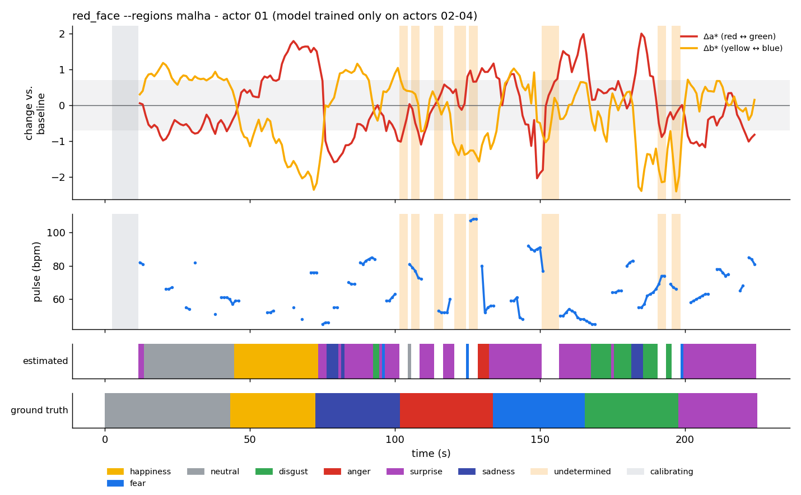
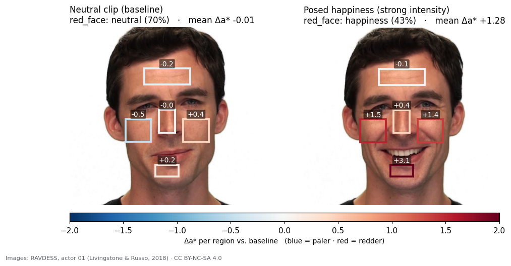
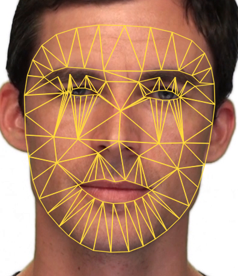
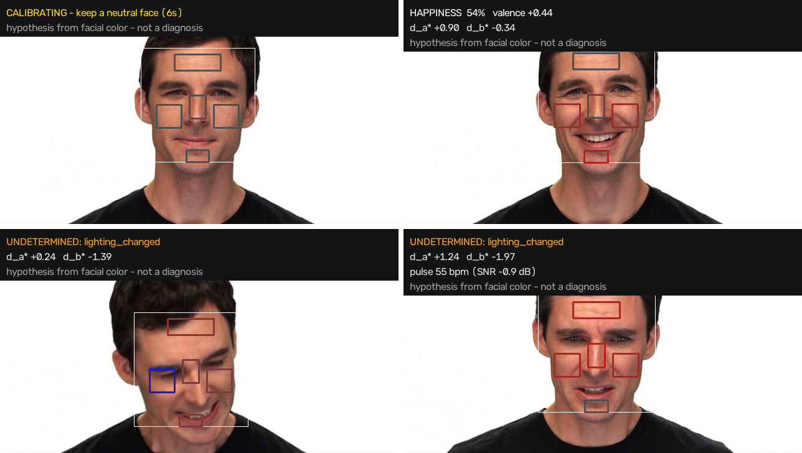
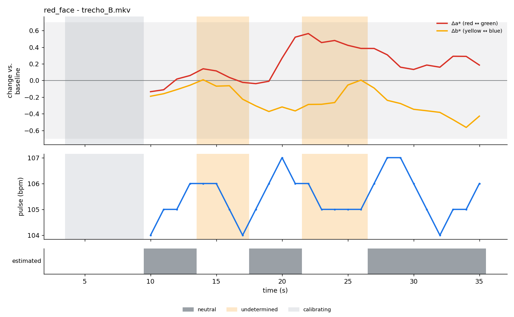

<div align="center">

# 🔴 red_face

**Emotion hypotheses from facial color, in ordinary video.**

Your face changes color subtly with what you feel: red with anger, pale with fear.
`red_face` measures those changes frame by frame, compares them with *your own* neutral state,
and says which emotion the color suggests — or admits that **it can't tell**.




<sub>A real person, never seen in training: RAVDESS actor 01 posing neutral, then 7 emotions, analyzed with
<code>redface analyze --regions malha</code> and a model trained only on actors 02–04.
Top: color change vs. baseline (grey band = below the human perception threshold). Middle: pulse from video.
Bottom: estimated emotion vs. ground truth. Happiness, surprise and disgust are mostly right; fear, sadness and anger are not.
Orange = windows the system refused to answer.</sub>

</div>

---

> [!WARNING]
> **This is not a lie detector, nor a detector of "true" emotion.**
> Facial color is a weak, *statistical* cue, mostly useful for telling positive from negative emotion and how aroused a person is.
> `red_face` produces **hypotheses** for research and experimentation. Read [Limits](#-limits-read-before-using) and [Ethics and law](#%EF%B8%8F-ethics-and-law) before using it on people.

## Contents

- [The idea in 30 seconds](#-the-idea-in-30-seconds)
- [Scientific basis](#-scientific-basis)
- [How it works](#%EF%B8%8F-how-it-works)
- [Installation](#-installation)
- [Quick start](#-quick-start)
- [Test on a real public video](#-test-on-a-real-public-video)
- [Evaluation on labeled datasets](#-evaluation-on-labeled-datasets)
- [Recording a video that works](#-recording-a-video-that-works)
- [Outputs](#-outputs)
- [Training on your own data](#-training-on-your-own-data)
- [Python API](#-python-api)
- [Limits](#-limits-read-before-using)
- [Ethics and law](#%EF%B8%8F-ethics-and-law)
- [Project structure](#-project-structure)
- [References](#-references)

## 💡 The idea in 30 seconds

1. **Calibrate.** For the first 10 s the person stays neutral. That becomes *their* baseline: the color of each facial region and their resting pulse.
2. **Measure.** Every second, a 4 s window is compared with the baseline: how much redder or greener each region became (Δa\*), how much yellower or bluer (Δb\*), how much the heart sped up, and how much the mouth widened (smile).
3. **Watch the camera.** It also looks at the *background*. If the background changed color, the camera or the light changed — not the blood — and the answer is **undetermined**.
4. **Suggest.** It compares the pattern with prototypes taken from the literature (anger = redder + higher pulse; fear = paler + higher pulse…), or with a model you trained, and returns probabilities, valence and confidence.

<div align="center">


<sub>A RAVDESS actor. Left: the neutral baseline. Right: posed happiness — the cheeks become ~1.5 a\* units redder, and the smile (wider mouth) is what tells this apart from an embarrassment blush.
Images: <a href="https://zenodo.org/records/1188976">RAVDESS</a>, Livingstone & Russo (2018), <a href="https://creativecommons.org/licenses/by-nc-sa/4.0/">CC BY-NC-SA 4.0</a>. This figure is distributed under the same license.</sub>
</div>

## 🔬 Scientific basis

The starting point is **Benitez-Quiroz, Srinivasan & Martinez (2018)**, *"Facial color is an efficient mechanism to visually transmit emotion"*, PNAS 115(14):3581–3586 ([PMC5889636](https://pmc.ncbi.nlm.nih.gov/articles/PMC5889636/)):

- they split the face into 126 regions and measured color in two opponent channels (red–green and yellow–blue);
- with color alone, a linear classifier reached **50% across 18 emotions** (chance: 5.5%) and **93% on valence** (positive vs. negative);
- people recognized emotions "painted" onto neutral faces, with no muscle movement at all, above chance (33% among 6 options; chance: 17%).

`red_face` builds on these ideas, with caution where the research calls for it:

| The paper… | So `red_face`… |
|---|---|
| used opponent color channels per region | measures CIELAB **a\*** (red–green) and **b\*** (yellow–blue) in 5 skin regions, or in a **133-triangle mesh** like the paper's |
| used regularized LDA + nearest mean | offers **the same LDA** for you to train on your own videos (`redface train`) |
| *assumed* the cause is blood flow but **did not measure it** | measures real blood signals: **pulse from video (rPPG/POS)** and the **erythema index** (hemoglobin) |
| used **still, posed photos** | works on **video**, always **against the person's own baseline** |
| is about emotion, **not lies** | same. There is no evidence that facial color detects lies |

And it adds what the physiology and perception literature supports:

- anger, embarrassment and happiness **increase** facial blood flow; fear **pales** the face (Drummond 1994–1999);
- the embarrassment blush concentrates on the **cheeks** (Drummond & Lim 2000);
- redder faces look angrier, bluish faces look sadder (Nakajima et al. 2017);
- people paint anger, happiness and surprise **redder and yellower**, and fear, sadness and disgust **less so** (Thorstenson et al. 2018);
- the threshold for noticing a change in redness is **~0.7 a\* units** (Re et al. 2011). The grey band in the plots marks that zone.

> [!NOTE]
> The full research behind the project — sources, caveats and what is **not** known — is in
> [`reports/Cor facial e emoção.md`](reports/Cor%20facial%20e%20emo%C3%A7%C3%A3o.md) (in Portuguese).

## ⚙️ How it works

```mermaid
flowchart LR
    V[🎥 video / webcam] --> D[face detection<br/><sub>YuNet · OpenCV<br/>or MediaPipe mesh</sub>]
    D --> R[skin regions<br/><sub>5 regions or 133 triangles<br/>mouth excluded</sub>]
    D --> S[smile<br/><sub>mouth width ÷ eye distance</sub>]
    D --> B[scene background<br/><sub>camera "witness"</sub>]
    R --> C[color per region<br/><sub>L* a* b* · erythema</sub>]
    R --> P[rPPG pulse<br/><sub>POS · Wang 2017</sub>]
    C --> LB{{baseline<br/>10 s neutral}}
    P --> LB
    S --> LB
    LB --> J[4 s window<br/><sub>Δ vs. baseline</sub>]
    B --> Q{quality<br/>control}
    J --> Q
    Q -- failed --> I[❔ undetermined<br/><sub>+ reason</sub>]
    Q -- ok --> E[🎯 likely emotion<br/><sub>probabilities · valence · confidence</sub>]
```

### The measurements

| Measure | What it is | Why it matters |
|---|---|---|
| **Δa\*** | change on the red ↔ green axis (CIELAB) | flushing (anger, embarrassment, happiness) vs. pallor (fear) |
| **Δb\*** | change on the yellow ↔ blue axis | happiness/anger look yellower; sadness looks bluer |
| **cheek − forehead** | where the redness concentrates | embarrassment reddens the cheeks; anger reddens the whole face |
| **erythema index** | `100·log10(R/G)` on linear RGB | tied to hemoglobin; insensitive to light intensity |
| **pulse (bpm)** | rPPG with the POS method | arousal: fear and anger speed up the heart |
| **smile** | mouth width ÷ distance between the eyes, vs. baseline | smiling **also** reddens the cheeks; without this cue, happiness gets labeled "embarrassment" |

Regions are placed using the **distance between the eyes**, which does not change with expression, and **lips and teeth are excluded** from all measurements. Without that, the chin region slid onto the mouth whenever the person smiled or talked, and red lips were read as a "blush".

### Two region modes

| | `--regions cinco` (default) | `--regions malha` |
|---|---|---|
| regions | 5 rectangles: forehead, both cheeks, nose, chin | **133 skin triangles** (MediaPipe Face Landmarker, 478 points, Delaunay; eyes, brows and mouth removed) — close to the paper's 126 |
| detector | YuNet (OpenCV, ~230 KB) | MediaPipe (`pip install -e ".[malha]"`, ~3.7 MB model) |
| classifier | literature prototypes **or** a trained LDA | a **trained LDA** to use the triangles (the literature says nothing about individual triangles); without `--model` the prototypes still answer and the triangle columns are recorded for training |
| best for | interpretable output, no training data | when you have labeled data to train on |

<div align="center">


<sub>The 133-triangle skin mesh. Image: RAVDESS, CC BY-NC-SA 4.0.</sub>
</div>

### Quality control ("when possible")

The color change we care about is **the same size** as the errors of an ordinary camera. So `red_face` prefers not answering to answering wrong. Every frame is checked, and a window becomes **undetermined** when:

| Reason (CSV value) | When it happens |
|---|---|
| `rosto_nao_detectado` — *no face* | face out of frame, or too little visible skin, in more than 30% of the frames |
| `movimento` — *motion* | the head moved more than 2% of the face width per frame, on average |
| `cena_mudou` — *scene changed* | the background changed brightness (ΔL\* > 4) or color (Δ > 1.5) in **any** frame: white balance, exposure or light |
| `iluminacao_mudou` — *lighting changed* | face brightness drifted more than 8 L\* from the baseline |
| `sem_linha_de_base` — *no baseline* | no good frames to calibrate within 30 s |

### The emotion prototypes

Without training, `red_face` compares the measured pattern with prototypes that turn the literature into numbers. The values are **heuristic**: they give direction and order of magnitude, not published measurements.

| Emotion | Δa\* | Δb\* | cheek − forehead | Δpulse | Δsmile | Valence |
|---|---:|---:|---:|---:|---:|---:|
| neutral | 0 | 0 | 0 | 0 | 0 | 0 |
| happiness | +1.5 | +1.0 | +1.0 | +3 bpm | +7.5% | +1 |
| surprise | +1.0 | +1.0 | 0 | +5 bpm | −1.5% | +0.3 |
| anger | +2.5 | +1.0 | 0 | +12 bpm | −1% | −1 |
| embarrassment | +2.5 | +0.5 | +1.5 | +8 bpm | +1.5% | −0.5 |
| fear | −2.0 | −1.0 | 0 | +12 bpm | 0 | −1 |
| sadness | −0.5 | −1.5 | 0 | −2 bpm | −1% | −1 |
| disgust | −1.5 | −0.3 | 0 | 0 | 0 | −1 |

Probabilities come from the distance to each prototype (Gaussian softmax). If the pulse could not be measured reliably, or there are no mouth landmarks (Haar detector or `--box`), that dimension is ignored.

The smile measured from YuNet's 5 points is small: a broad smile shows up as only **+6 to 10%** wider mouth, and the noise of a neutral face talking is about ±2%. The scale was calibrated on 2 RAVDESS actors.

## 📦 Installation

```bash
git clone <this-repository> red_face && cd red_face
python -m venv .venv && source .venv/bin/activate
pip install -e ".[plot]"          # [plot] adds matplotlib for the charts
pip install -e ".[malha]"         # optional: MediaPipe, for --regions malha
```

Dependencies: `numpy`, `scipy`, `opencv-python`; optionally `matplotlib` and `mediapipe`. Installing `ffmpeg` is recommended (it is used to read videos).

On first run, the models are downloaded to `~/.cache/redface/` and checked by SHA-256:

| Model | Size | Used by | Offline override |
|---|---|---|---|
| YuNet face detector ([OpenCV Zoo](https://github.com/opencv/opencv_zoo/tree/main/models/face_detection_yunet)) | ~230 KB | default mode | `REDFACE_YUNET=/path/model.onnx` |
| MediaPipe Face Landmarker | ~3.7 MB | `--regions malha` | `REDFACE_FACEMESH=/path/face_landmarker.task` |

On OpenCV 4.x you can also use `--detector haar`, which needs no download. OpenCV 5 removed the Haar cascades.

To run the tests: `pip install -e ".[dev]" && pytest`.

## 🚀 Quick start

> [!NOTE]
> The code base and data keys are in Portuguese (the project started in Brazil).
> **Everything you see on screen** — `--help`, terminal output, video overlay and charts — follows your system language, or `--lang en|pt` (e.g. `redface --lang en analyze --help`).
> CSV/JSON keys and values stay the same in every language; the [Outputs](#-outputs) section has an English glossary.

### 1. See it working, no camera needed

```bash
redface --lang en demo
```

It generates a synthetic video with a blush, a pallor and an exposure jump, analyzes it, and saves the chart and CSV to `demo/`:

```text
[  26.0–  30.0s] anger       87%  valence -0.88  Δa* +2.93  Δb* +0.98  pulse  87.0 bpm
[  52.0–  56.0s] fear        97%  valence -1.00  Δa* -2.43  Δb* -1.18  pulse  89.0 bpm
[  66.0–  70.0s] undetermined (lighting_changed, scene_changed)  Δa* +3.94  Δb* +3.68  pulse  73.0 bpm

correct on settled windows: 23/23
light-jump windows refused: 10/10
```

> [!IMPORTANT]
> The demo validates the **software** (measurement, baseline, quality control), not the **science**.
> The synthetic video and the prototypes follow the same assumptions, so getting it right is expected.
> Note the light jump: without the background "witness" it would be read as Δa\* = +4, i.e. **anger**.

### 2. Analyze a video

```bash
redface analyze interview.mkv --plot --annotated
```

<div align="center">


<sub>The overlay on a real person (RAVDESS actor 01, <code>--annotated</code>): calibrating; happiness (cheeks +0.9 a\*, wider mouth);
and two windows the system <b>refused</b> — the actor leans and turns, the light on the face changes, and the answer is "undetermined" rather than a guess.
Images: RAVDESS, CC BY-NC-SA 4.0.</sub>
</div>

| Option | Purpose |
|---|---|
| `-o DIR` | where to save (default `saida/`) |
| `--plot` | writes `linha_do_tempo.png` (timeline chart) |
| `--annotated` | writes `anotado.avi` with the overlay |
| `--baseline 10` | initial seconds treated as neutral |
| `--window 4` | analysis window length (s) |
| `--regions cinco\|malha` | 5 regions (default) or 133-triangle mesh (pair it with a mesh-trained `--model`) |
| `--box x,y,w,h` | fixed face box (skips detection; good with a chin rest) |
| `--detector yunet\|haar` | face detector (default: YuNet) |
| `--reader ffmpeg\|opencv` | video reader (default: ffmpeg if installed; OpenCV crashes on some large uncompressed AVIs) |
| `--model model.json` | use a trained LDA instead of the prototypes |
| `--label raiva` | tag the video with a label (for training) |
| `--lang en\|pt` | display language (goes **before** the command: `redface --lang en analyze …`) |

If the video uses lossy compression (H.264, MP4V, VP9…), `red_face` warns you: compression erases subtle color changes (McDuff et al. 2017).

### 3. Live from the webcam

```bash
redface live --camera 0
```

It waits ~1.5 s for the camera to adapt to the light and then **tries to lock** auto white balance and exposure. Stay neutral during the calibration countdown. Press `q` to quit.

> [!TIP]
> Many webcams ignore OpenCV's lock request. On Linux, lock them by hand first:
> ```bash
> v4l2-ctl -d /dev/video0 -c white_balance_automatic=0 -c auto_exposure=1
> ```
> (control names vary; see `v4l2-ctl -d /dev/video0 -l`).

## 🧪 Test on a real public video

`red_face` was tested on a public interview:
[*Interview on extreme weather with physical geographer Hannah Cloke*](https://commons.wikimedia.org/wiki/File:Interview_on_extreme_weather_with_physical_geographer_Hannah_Cloke_%E2%80%93_The_Royal_Society.webm),
by **The Royal Society**, license **CC BY 3.0**, via Wikimedia Commons. The original is 1080p, 25 fps, VP9 (lossy), and edited with camera cuts.

```bash
# clips cut without further loss (FFV1) from the downloaded file
ffmpeg -ss 76.5  -i cloke.webm -t 34  -vf scale=960:540 -an -c:v ffv1 clip_A.mkv   # continuous close-up
ffmpeg -ss 367.5 -i cloke.webm -t 36  -vf scale=960:540 -an -c:v ffv1 clip_B.mkv   # continuous close-up
ffmpeg -ss 0     -i cloke.webm -t 180 -vf scale=960:540 -an -c:v ffv1 clip_C.mkv   # 3 min with cuts
redface --lang en analyze clip_B.mkv -o res_B --plot --annotated
```

| Clip | Windows answered | Result | Δa\* (range) | Pulse |
|---|---|---|---|---|
| A: continuous shot, 34 s | 14 of 24 | 100% `neutral` | −0.13 to +0.52 | ~105 bpm (SNR ≈ 0 dB) |
| B: continuous shot, 36 s | 17 of 26 | 100% `neutral` | −0.14 to +0.52 | ~105 bpm (SNR ≈ 0 dB) |
| C: 3 min with cuts | 0 of 170 | all `undetermined` | — | — |

<div align="center">

</div>

**How to read it:**

- **The color stayed put.** In a calm interview, Δa\* never left the grey band, below the perception threshold (~0.7). The system answered `neutral` and did not invent an emotion.
- **Quality control did its job.** In the continuous shots, about a third of the windows were refused for `scene_changed` / `lighting_changed`: the production camera moves slightly and the background shifts. In the clip with cuts, after the first cut to another person or framing, **nothing** was answered. That is correct, because the baseline no longer applies.
- **The pulse is not verified.** The ~105 bpm peak shows up on the face in both clips and not consistently in the background, so it probably doesn't come from the codec. But the SNR is low (≈ 0 dB) and there is no reference measurement: treat that number as plausible, not confirmed.
- **The test found two bugs, now fixed.** OpenCV 5 removed the Haar detector, which led to the switch to YuNet. And the regions landed on hair and eyes, which led to placing them from the eye landmarks.

> [!NOTE]
> This tests that the software **works and behaves cautiously** on real video. It is **not** validation that it recognizes emotions: that needs labeled videos with induced emotion, recorded under the conditions in the [recording guide](#-recording-a-video-that-works).

## 📊 Evaluation on labeled datasets

Datasets with genuinely **induced** emotion (MAHNOB-HCI, DEAP, BP4D, UBFC-Phys, BAUM-1…) require a license agreement, an e-mail request or registration. You can apply, but not download directly. So two open datasets were used, each testing one half of the system.

### Pulse: UBFC-rPPG (uncompressed video + pulse oximeter)

[UBFC-rPPG](https://sites.google.com/view/ybenezeth/ubfcrppg), DATASET_2, subjects 12–15. Webcam video, 640×480 at ~30 fps, uncompressed. Subjects play a math game designed to **raise their heart rate**, while a CMS50E oximeter records the reference.

| Subject | Oximeter | Mean error | Windows within 5 bpm |
|---|---|---|---|
| 12 | 59–68 bpm | 2.8 bpm | 83% |
| 13 | 96–116 bpm | 2.4 bpm | 90% |
| 14 | 73–98 bpm | 9.0 bpm | 29% |
| 15 | 111–121 bpm | 7.1 bpm (median 3.0) | 83% of the 12 windows with a reliable pulse |
| **total** (98 windows of 10 s) | | **5.0 bpm** (median 3.0; RMSE 7.9) | **69%** |

<sub>Measured before the eye-distance region placement and the mouth exclusion; the pulse regions (forehead and cheeks) changed little.</sub>

The pulse works on good video. Subject 14, whose pulse changes fast, shows the lag of the 10 s window. Quality control refused 22 of 118 windows because **face and background changed color together**: the camera or room light drifts during the recording.

> [!WARNING]
> On these same windows, which contain **no emotion at all** (only mental effort), the prototypes answered `disgust` 43 times and `fear` 13 times. Color and pulse changes caused by stress, light and camera turn into "emotion" if you are not careful. **That is the size of the false-positive problem.**

### Color vs. emotion: RAVDESS (emotions posed by actors)

[RAVDESS](https://zenodo.org/records/1188976), license CC BY-NC-SA 4.0, actors 1–4, 240 video clips of 3–4 s (H.264), 8 emotions at 2 intensities. These emotions are **posed**, like the photos in the PNAS paper, **not induced**.

**Average change per emotion** (vs. the same actor's neutral clips; mouth excluded; [`scripts/eval_ravdess.py`](scripts/eval_ravdess.py)):

| Emotion | Δa\* (red) | Δb\* (yellow) | ΔL\* (brightness) | Δsmile |
|---|---:|---:|---:|---:|
| happiness | **+0.65** ± 0.08 (strong: +0.90) | −0.74 | −1.18 | **+5%** |
| calm | +0.07 | +0.34 | +0.03 | +2% |
| sadness | +0.05 | −0.24 | −0.90 | +2% |
| fear | +0.17 | −0.24 | −1.10 | +2% |
| surprise | −0.05 | +0.12 | −0.73 | +1% |
| disgust | −0.08 | **−1.21** | **−3.02** | +1% |
| anger | **−0.19** ± 0.16 | −0.46 | −0.91 | 0% |

**Classification, leaving one actor out** (7 classes; chance 14.3%):

| Classifier | Features | Per clip ([`compare_mesh.py`](scripts/compare_mesh.py)) | Through the product, per window ([`ravdess_sequences.py`](scripts/ravdess_sequences.py)) |
|---|---:|---|---|
| literature prototypes (no training) | 5 | 21.2% | — |
| LDA, 5 regions | 15 | 33% | — |
| LDA, 5 regions + smile + pulse | 17 | 34% | **33.5%** |
| **LDA, 133-triangle mesh** (mean a\*, b\*) | 266 | **~50%** | **45.5%** |
| LDA, mesh (mean + variance, as in the paper) | 532 | 32–41% | — |
| *control: mesh with shuffled labels (20×)* | 266 | *14% (max 19%)* | — |

<sub>"Per clip" uses each clip's mean color against the actor's neutral clips; always guessing "neutral" gives 20.0%. "Through the product" concatenates each actor's clips into one continuous video (4 neutral clips first, as the baseline), runs <code>redface analyze</code> and <code>redface train</code>, and scores 3 s windows that fall entirely inside one clip; the majority class there is ~16–17%. Prototype valence (happiness vs. negative emotions): AUC 0.74 (chance 0.50). LDA numbers move a few points with the shrinkage (0.1 to 0.9), but the ranking does not change.</sub>

**What this says:**

- **Only happiness follows the literature** (redder cheeks, above the perception threshold at strong intensity). **Posed anger does not redden**: an actor faking anger lacks the flush of felt anger. So the prototypes barely beat guessing "neutral" on posed material.
- **The dense mesh does much better than 5 regions** (~46–50% vs. ~33%), and the shuffled control shows it is not luck. **But almost all of the gain comes from the triangles next to the eyes, brows and mouth**: those alone give 49%, while the 18 triangles far from them give only 38%. The yellow–blue channel (b\*) carries more than red–green (a\*): 51% vs. 39%. The most likely reading is that the mesh captures **expression through color** (brow shadows, wrinkles, stretched skin), not blood flow — exactly the confound the PNAS paper could not rule out.
- **Mean + variance (532 features) is worse**: with 240 clips, too many features become noise.
- On the held-out actor in the chart at the top: happiness 26/26, surprise 24/24 and disgust 19/24 windows right, but fear 0/23, sadness 5/26 and anger 4/16 — overall **56.1%** of emotional windows.
- 4 actors, compressed video and 3–4 s clips — too short for pulse and blushing (a blush takes 15–20 s). It is a small test: it points a direction, it does not settle the question.

**Honest conclusion:** on ordinary video, `red_face` measures **pulse** reasonably well and detects **camera and lighting changes**. Facial color separates **posed** emotions above chance, especially with the dense mesh, but **most of that signal seems to come from expression, not blood**. On people under stress, it produces false positives. The way forward is a dataset with **induced** emotion, uncompressed video and a reference pulse, such as UBFC-Phys or MAHNOB-HCI (on registration).

## 🎬 Recording a video that works

The signal you are looking for (Δa\* of 1 to 3) is the size of a camera calibration error (ΔE ≈ 2). The recording decides almost everything.

- [ ] **White balance, exposure, gain and focus locked.** Auto mode is enemy number one.
- [ ] **Diffuse, constant light**: no sun coming and going, no lamp flickering at 50/60 Hz.
- [ ] **No lossy compression**: FFV1 (`ffmpeg -c:v ffv1`), PNG, or H.264 with CRF ≤ 10.
- [ ] **30 fps or more**, with the face filling a good part of the frame.
- [ ] **Head reasonably still** (a chin rest is great; use `--box`).
- [ ] **A still, visible background** on both sides of the face: it is what gives the camera away.
- [ ] **10 neutral seconds at the start** of every video. Each video is only compared with itself.
- [ ] If you can, a **grey card** in the scene.

Social media videos, video calls and phone recordings in auto mode **are not suitable** for measuring color. You will get a result, but it reflects the camera, not the person.

## 📄 Outputs

`redface analyze` writes to the output folder:

| File | Contents |
|---|---|
| `janelas.csv` | one row per window: status, reasons, emotion, confidence, valence, pulse, Δa\*/Δb\*/Δerythema **per region**, Δsmile, mesh deltas (in mesh mode) and the probability of each emotion |
| `resumo.json` | counts, fraction answered, refusal reasons, mean pulse, baseline values, warnings (codec, fps) |
| `linha_do_tempo.png` | the timeline chart (`--plot`) |
| `anotado.avi` | the video with the overlay (`--annotated`) |

Example `resumo.json` (clip B above):

```json
{
  "codec": "ffv1",
  "classificador": "prototipos",
  "janelas": { "calibrando": 6, "ok": 17, "indeterminado": 9 },
  "fracao_respondida": 0.531,
  "emocoes": { "neutro": 17 },
  "motivos_indeterminado": {
    "cena_mudou": { "n": 8, "explicacao": "o fundo mudou de cor/brilho: a câmera (balanço de branco/exposição) ou a luz mudou" },
    "iluminacao_mudou": { "n": 4, "explicacao": "o brilho do rosto mudou muito em relação à linha de base" }
  },
  "pulso_medio_bpm": 105.5
}
```

<details>
<summary><b>Glossary of data keys (Portuguese → English)</b></summary>

| Key / value | Meaning |
|---|---|
| `janelas`, `t_inicio`, `t_fim` | windows, window start, window end (s) |
| `status`: `calibrando` / `ok` / `indeterminado` | calibrating / answered / undetermined |
| `motivos` | refusal reasons (see [quality control](#quality-control-when-possible)) |
| `emocao`, `confianca`, `valencia` | emotion, confidence, valence |
| `neutro`, `alegria`, `surpresa`, `raiva`, `vergonha`, `medo`, `tristeza`, `nojo` | neutral, happiness, surprise, anger, embarrassment, fear, sadness, disgust |
| `d_vermelho`, `d_amarelo` | mean Δa\* (redness), mean Δb\* (yellowness) |
| `bochecha_menos_testa` | cheek minus forehead Δa\* |
| `d_pulso`, `pulso_bpm`, `pulso_snr_db` | pulse change, pulse (bpm), pulse SNR (dB) |
| `d_sorriso` | smile change (relative mouth width) |
| `testa`, `bochecha_esq`, `bochecha_dir`, `nariz`, `queixo` | forehead, left cheek, right cheek, nose, chin |
| `_da`, `_db`, `_dei` suffixes | Δa\*, Δb\*, Δerythema index of that region |
| `malha_042_da` | Δa\* of mesh triangle 42 |
| `rotulo`, `fonte` | label, source (training columns) |
| `classificador`: `prototipos` / `lda` | prototypes / trained LDA |
| `fracao_respondida`, `motivos_indeterminado`, `explicacao` | fraction answered, undetermined reasons, explanation |
| `pulso_medio_bpm`, `linha_de_base`, `avisos`, `aviso` | mean pulse, baseline, warnings, disclaimer |

</details>

## 🧠 Training on your own data

The prototypes are a starting point. If you have labeled videos (for example, people watching film clips that induce emotions), you can train the same kind of classifier as the PNAS paper:

```bash
# 1. one labeled CSV per video (every video starts with 10 neutral seconds!)
redface analyze p01_anger.mkv   -o data/p01_anger   --label raiva --regions malha
redface analyze p01_neutral.mkv -o data/p01_neutral --label neutro --regions malha
redface analyze p02_fear.mkv    -o data/p02_fear    --label medo   --regions malha
# ...

# 2. train; accuracy is estimated by leaving one video out at a time
redface train data/*/janelas.csv -o model.json

# 3. use it (with the same --regions you trained on)
redface analyze new.mkv --regions malha --model model.json
```

The model uses whatever features the CSVs contain: Δa\*, Δb\* and Δerythema for each of the 5 regions, Δpulse and Δsmile, plus Δa\*/Δb\* of each mesh triangle when you analyzed with `--regions malha` (use `--no-mesh` to leave those out). Features are standardized and the LDA is shrinkage-regularized (default 0.3), as in the paper. Labels are free text; use the Portuguese names above if you want valence and colors in the charts.

> [!CAUTION]
> **Always report the chance rate** and evaluate with **different people** in training and testing. Windows from the same video are nearly identical; mixing them across train and test inflates accuracy.
> To evaluate properly, split by person (one folder per subject) and report results **by skin tone**: rPPG and blushing are harder to measure on dark skin (Nowara et al. 2020).
> [`scripts/ravdess_sequences.py`](scripts/ravdess_sequences.py) is a complete leave-one-person-out example.

## 🐍 Python API

```python
from redface import FaceColorAnalyzer, AnalyzerConfig
from redface.video import VideoReader

reader = VideoReader("video.mkv")              # ffmpeg if available, else OpenCV
fps = reader.info.fps
analyzer = FaceColorAnalyzer(fps, AnalyzerConfig(baseline_s=10, window_s=4))

for i, frame in reader:
    for window in analyzer.process(frame, t=i / fps):
        if window.status == "ok":
            p = window.prediction
            print(f"{window.t_end:5.1f}s  {p.label:<9} {p.confidence:.0%}  valence {p.valence:+.2f}")
            print("   Δa* per region:", {r: round(d[1], 2) for r, d in window.delta.items()})
        else:
            print(f"{window.t_end:5.1f}s  {window.status}  {window.reasons}")
```

Mesh mode with a trained model:

```python
from redface.emotion import LDAClassifier
from redface.mesh import MeshFaceTracker

analyzer = FaceColorAnalyzer(fps, tracker=MeshFaceTracker(), classifier=LDAClassifier.load("model.json"))
```

The parts are swappable:

- `tracker=`: any object with `update(frame) -> (x, y, w, h) | None`, such as `YuNetFaceTracker` (default), `MeshFaceTracker`, `HaarFaceTracker`, `FixedBox`, or your own. If it exposes `landmarks` (5 points) you get the smile and mouth exclusion; if it exposes `mesh_points` you get the triangle mesh.
- `classifier=`: any object with `predict(delta, d_hr, d_smile) -> Prediction`, such as `PrototypeClassifier`, `LDAClassifier.load(...)` or your own. `LDAClassifier.predict_features(dict)` takes features by name.
- `AnalyzerConfig`: every threshold (motion, background drift, pulse SNR…) is adjustable.
- `redface.i18n.set_lang("en")`, then `label("raiva")` → `"anger"`: translates internal labels for display.

## 🚧 Limits (read before using)

- **The base paper did not measure blood.** It showed that *color in photos* separates emotions; the vascular mechanism is a hypothesis. The only independent replication (Thorstenson, Pazda & Krumhuber 2021) found a benefit from color only on moving faces.
- **Color mostly indicates valence and arousal**, not 18 emotions. Expect confusion: anger vs. embarrassment vs. happiness (they all redden), sadness vs. disgust.
- **The prototypes are heuristic.** No published measurement says how much Δa\* a natural anger flush produces.
- **The mesh's extra accuracy is mostly expression, not blood** (see [evaluation](#-evaluation-on-labeled-datasets)). If you want facial expression, a dedicated action-unit model will do better.
- **Felt emotion ≠ expressed emotion ≠ color.** Heat, exercise, alcohol, fever, make-up and medication change facial color. Barrett et al. (2019), a review co-authored by Martinez, shows that not even facial *movement* allows reliable emotion inference.
- **Dark skin:** the blush and pulse signals get weaker. The system tends to answer less often (or worse) in those cases.
- **Edited videos:** the baseline holds for one continuous shot. After a camera cut, everything becomes `undetermined` (see [real video test](#-test-on-a-real-public-video)). Faces in strong profile are lost.
- **Pulse** needs ~10 s of clean signal and lags reality by a few seconds.

## ⚖️ Ethics and law

- **Lies: no.** No facial signal (color, temperature, micro-expressions) has been validated for lie detection. People score ~54% (Bond & DePaulo 2006), and systems such as iBorderCtrl were heavily criticized. Do not use `red_face` for that.
- **Brazil (LGPD):** face video is **biometric data**, i.e. **sensitive** personal data (art. 5, II; art. 11). It requires a legal basis — usually specific, highlighted consent — a clear purpose, minimization and, in practice, a data protection impact assessment (RIPD). Bill PL 2338/2023 (AI), still in Congress, treats emotion recognition as **high risk**.
- **European Union (AI Act):** inferring emotions **in the workplace and in schools is prohibited** since February 2025 (art. 5(1)(f)); in other contexts it is high risk.
- **In practice:** no HR, job interviews, classrooms, police or borders. Ask for consent, explain what is measured, keep the minimum and show the results to the person themselves.

## 🗂 Project structure

```text
red_face/
├── src/redface/
│   ├── color.py      # Lab a*/b*, erythema index, skin mask
│   ├── regions.py    # face detection (YuNet/Haar), 5 skin regions, mouth exclusion, smile, background witness
│   ├── mesh.py       # 133-triangle mesh mode (MediaPipe)
│   ├── data/         # the fixed triangulation (malha_133.json)
│   ├── rppg.py       # pulse from video (POS) + SNR
│   ├── pipeline.py   # baseline, windows, quality control
│   ├── emotion.py    # literature prototypes + trainable LDA
│   ├── synth.py      # synthetic video with known ground truth (demo, tests)
│   ├── video.py      # video reading (ffmpeg or OpenCV)
│   ├── viz.py        # overlay and timeline chart
│   ├── i18n.py       # display language (en/pt)
│   └── cli.py        # redface analyze | live | demo | train
├── tests/            # pytest: color, pulse, classifiers, video reader, mesh, pipeline
├── scripts/          # RAVDESS and UBFC-rPPG evaluation, 5 regions vs. mesh, README images
├── docs/img/         # README images (scripts/readme_images.py)
├── reports/          # the research report behind the project (Portuguese)
└── research_notes/   # research notes with sources
```

### Possible next steps

- hemoglobin vs. melanin separation by ICA (Tsumura et al. 2003), to isolate blood from expression;
- color normalization with a grey card in the scene;
- fusion with facial action units (py-feat / OpenFace), which is where most of the valence information is;
- evaluation on an induced-emotion dataset with reference physiology (UBFC-Phys, MAHNOB-HCI).

## 📚 References

- Benitez-Quiroz, C. F., Srinivasan, R., & Martinez, A. M. (2018). Facial color is an efficient mechanism to visually transmit emotion. *PNAS*, 115(14), 3581–3586. [doi:10.1073/pnas.1716084115](https://doi.org/10.1073/pnas.1716084115)
- Thorstenson, C. A., Pazda, A. D., & Krumhuber, E. G. (2021). The influence of facial blushing and paling on emotion perception and memory. *Motivation and Emotion*, 45, 818–830. [doi:10.1007/s11031-021-09910-5](https://doi.org/10.1007/s11031-021-09910-5)
- Thorstenson, C. A., Elliot, A. J., Pazda, A. D., Perrett, D. I., & Xiao, K. (2018). Emotion-color associations in the context of the face. *Emotion*, 18(7), 1032–1042.
- Nakajima, K., Minami, T., & Nakauchi, S. (2017). Interaction between facial expression and color. *Scientific Reports*, 7, 41019.
- Re, D. E., Whitehead, R. D., Xiao, D., & Perrett, D. I. (2011). Oxygenated-blood colour change thresholds for perceived facial redness, health, and attractiveness. *PLoS ONE*, 6(3), e17859.
- Drummond, P. D. (1999). Facial flushing during provocation in women. *Psychophysiology*, 36(3), 325–332.
- Drummond, P. D., & Lim, H. K. (2000). The significance of blushing for fair- and dark-skinned people. *Personality and Individual Differences*.
- Wang, W., den Brinker, A. C., Stuijk, S., & de Haan, G. (2017). Algorithmic principles of remote PPG. *IEEE TBME*, 64(7), 1479–1491.
- de Haan, G., & Jeanne, V. (2013). Robust pulse rate from chrominance-based rPPG. *IEEE TBME*, 60(10), 2878–2886.
- McDuff, D., Blackford, E. B., & Estepp, J. R. (2017). The impact of video compression on remote cardiac pulse measurement using imaging photoplethysmography. *IEEE FG 2017*.
- Nowara, E. M., McDuff, D., & Veeraraghavan, A. (2020). A meta-analysis of the impact of skin type and gender on non-contact photoplethysmography measurements. *CVPR Workshops*.
- Tsumura, N., et al. (2003). Image-based skin color and texture analysis/synthesis by extracting hemoglobin and melanin information in the skin. *ACM SIGGRAPH*.
- Barrett, L. F., Adolphs, R., Marsella, S., Martinez, A. M., & Pollak, S. D. (2019). Emotional expressions reconsidered. *Psychological Science in the Public Interest*, 20(1), 1–68.
- Bond, C. F., & DePaulo, B. M. (2006). Accuracy of deception judgments. *Personality and Social Psychology Review*, 10(3), 214–234.
- Livingstone, S. R., & Russo, F. A. (2018). The Ryerson Audio-Visual Database of Emotional Speech and Song (RAVDESS). *PLoS ONE*, 13(5), e0196391. Images used here under [CC BY-NC-SA 4.0](https://creativecommons.org/licenses/by-nc-sa/4.0/).
- Bobbia, S., Macwan, R., Benezeth, Y., Mansouri, A., & Dubois, J. (2019). Unsupervised skin tissue segmentation for remote photoplethysmography. *Pattern Recognition Letters*, 124, 82–90 (UBFC-rPPG).

---

<div align="center">
<sub>Made for research and curiosity. Facial color tells part of the story — never the whole story.</sub>
</div>
